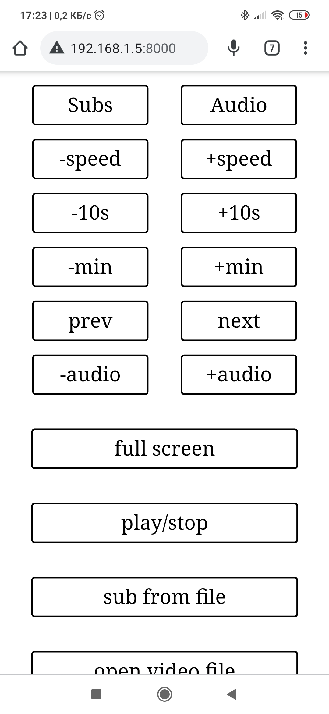
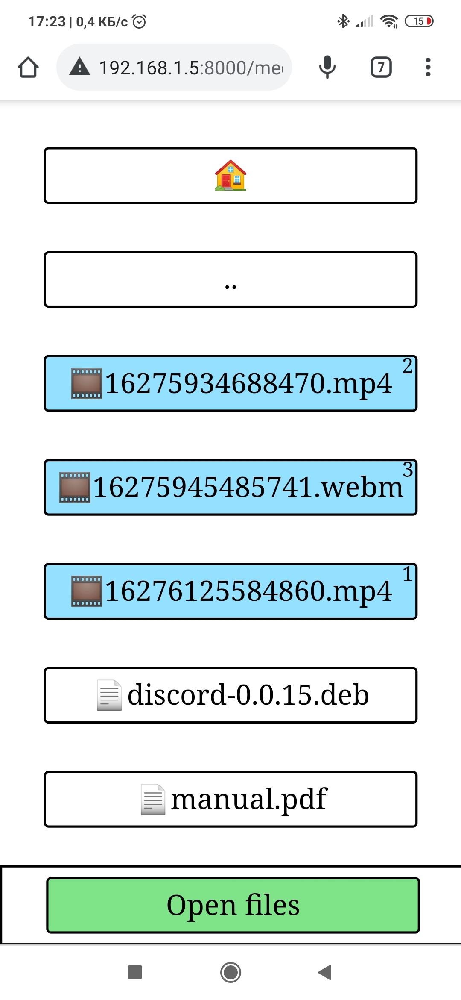

# MPV remote controller

MPV remote controller is a program for remote controlling mpv player with device in your local network through web browser.

## Features
- switch subtitles/audio
- controlling speed
- pause/play
- fullscreen
- next/prev file in playlist
- controlling volume
- subtitles from file
- append media file to playlist
- open media file and start mpv

## Requirements
- [python 3](https://www.python.org/)

## Usage

### Run server

```sh
python mpv-remote.py
```

Open your browser at **your_local_ip:8000** and control mpv remotely.

### Configuration

Defaults (used when env vars are not set):

| Setting | Default |
|---------|---------|
| `SOCKET_PATH` | `/tmp/mpvsocket` |
| `SERVER_ADDRESS` | `0.0.0.0:8000` |

Override via environment variables:

```sh
export SOCKET_PATH=/tmp/mpvsocket
export SERVER_ADDRESS=0.0.0.0:8000
python mpv-remote.py
```

### Open files by double click

If you want to control mpv opened by double-clicking a media file, add this to `mpv.conf`:

```
input-ipc-server=/tmp/mpvsocket
```

Use the same path as `SOCKET_PATH` (default above, or your custom value).

## Screenshots

<p align="center">


</p>
